# Resurge — a free, self-improving AI competitive-intelligence company

Resurge runs competitor research the way a consulting firm would: **22 specialised agents in 10 departments**
(Executive Office, Strategy, Research, QA, Analysis, Risk, Communications, Learning, plus a CTO model-router and a
CFO budget office) hand work to each other through schema-validated contracts. Every claim is tied to a source URL and a
verbatim quote. Each claim is fact-checked by a *different model family* than the one that extracted it, then scored
for confidence. The results are published as a **one-page HTML report, PDF, PowerPoint deck, Markdown, JSON,
Google Sheets and Slack/Discord alerts**.

The system **costs $0 to run.** It routes every task across the free tiers of Groq, Google AI Studio (Gemini / Gemma),
OpenRouter `:free`, Mistral, NVIDIA NIM, Cloudflare, Cerebras (trial credits) and local Ollama. Rate-limit-aware
failover, caching and a knowledge base keep it inside quota. It also **gets better every run**: validated outcomes
update model reputations, source reliability, search strategy and ACE-style playbooks injected into each agent's
prompt.

```
resurge run "Notion" --competitors "Coda,ClickUp,Confluence" --depth standard
```


**Contents:** [Quick start](#quick-start) · [How it works](#how-it-works) · [The company](#the-company) ·
[Deliverables](#deliverables-all-free-formats) · [Validation](#validation-the-part-that-makes-it-trustworthy) ·
[Security](#security--compliance-no-blocks-nothing-illegal-injection-resistant) ·
[Self-improvement](#self-improvement-four-feedback-loops) · [Hosted web app](#hosted-web-app-log-in-type-a-company) ·
[Chat](#ask-your-research-rag-chat) · [CLI](#cli)

---

## Quick start

```bash
cd resurge
uv venv && uv pip install -e ".[web,rag,gsheets,dev]"  # or: python -m venv .venv && pip install -e ".[web,rag]"
source .venv/bin/activate
resurge init        # creates .env and lists where to get FREE keys (~1 minute each, no card)
resurge doctor      # verifies keys against each provider's live /models list, shows search backends
resurge demo        # instant sample deliverables (fictional data, no keys)
resurge run "Linear" --depth quick                # auto-discovers competitors
resurge ui          # dashboard at http://127.0.0.1:8765

# the website (landing page + multi-user app), needs Node 20+ to build once
cd frontend && npm install && npm run build && cd ..
resurge serve --host 127.0.0.1 --port 8000        # http://127.0.0.1:8000
```

One free key is enough to start: **Groq**, **Gemini (AI Studio)** or **OpenRouter**. More keys add more capacity and more
model diversity, which helps cross-model verification. **No key at all?** `ollama pull qwen2.5:7b` and run with `--local`.
That is 100% private and unlimited, but lower quality.

Search needs **no keys** and uses only sanctioned access: Parallel's free hosted MCP server (web and news) plus the
official Hacker News, Wikipedia and GitHub APIs. Official search APIs with free tiers (Tavily, Exa, Jina, Serper,
Brave, your own SearXNG) are picked up automatically when their keys are present and noticeably improve coverage.
Unofficial search-engine scraping (`ddgs`) and Google News RSS are **off** unless you opt in with
`RESURGE_ALLOW_UNOFFICIAL_SEARCH=1` (see [compliance](docs/COMPLIANCE.md)). Set `RESURGE_CONTACT` so sites know who is
crawling.

---

## How it works

### Architecture

Four ways in, one engine. Agents never call a model or the web directly: every model call goes through the gateway
(routing, quotas, failover) and every page goes through the fetcher (robots.txt, site terms, safe addresses).

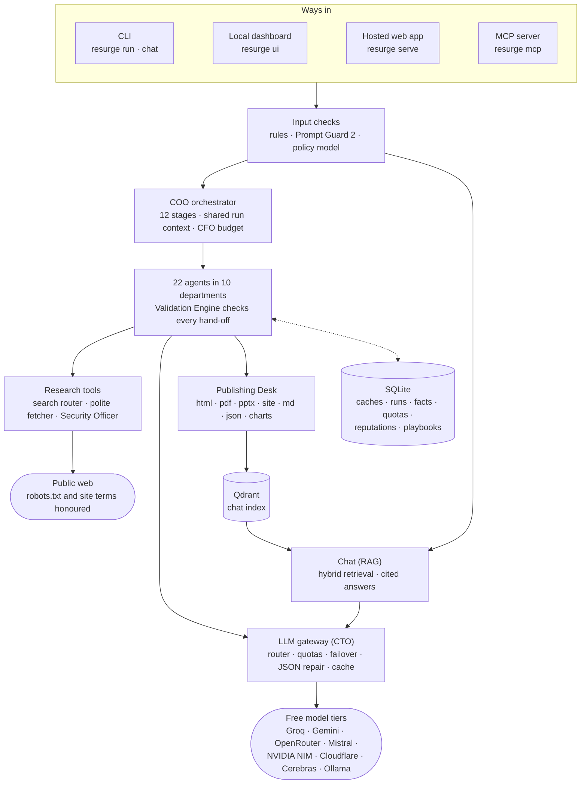

Which checks run where: chat questions get every layer on every surface. Research requests get every layer in the
hosted app; the local dashboard and MCP server clean them and reject instruction-like text; the CLI is the operator's
own terminal and skips request checks. Web pages are screened separately by the Security Officer on every run.

| Component | Code | What it does |
|---|---|---|
| CLI, dashboard, MCP server | [`cli.py`](src/resurge/cli.py), [`web/app.py`](src/resurge/web/app.py), [`mcp_server.py`](src/resurge/mcp_server.py) | Start runs, follow progress, open reports, ask questions |
| Website | [`frontend/`](frontend) (React, Next.js) | Landing page (what it is, how to use it, how it works) and the app: sign-up, dashboard, progress, account, admin |
| Hosted web app | [`web/hosted.py`](src/resurge/web/hosted.py), [`web/accounts.py`](src/resurge/web/accounts.py) | JSON API, serves the website, accounts, sessions, daily limits, run queue, admin and audit log |
| Input checks | [`input_guard.py`](src/resurge/input_guard.py), [`guardrails.py`](src/resurge/guardrails.py) | Shape and rule checks, Prompt Guard 2, acceptable-use policy model, output checks |
| Orchestrator | [`pipeline/orchestrator.py`](src/resurge/pipeline/orchestrator.py), [`pipeline/context.py`](src/resurge/pipeline/context.py) | Runs the 12 stages; the run context is the shared blackboard every agent reads and writes |
| Agents | [`agents/`](src/resurge/agents/) (org chart in [`org.py`](src/resurge/agents/org.py)) | One module per department; each agent has a job title, a mission and a model role |
| Validation | [`agents/quality.py`](src/resurge/agents/quality.py), [`text.py`](src/resurge/text.py) | Quote grounding, citation integrity, confidence scores, QA gates, BM25 |
| Model gateway | [`llm/gateway.py`](src/resurge/llm/gateway.py), [`llm/ratelimit.py`](src/resurge/llm/ratelimit.py), [`llm/registry.py`](src/resurge/llm/registry.py), [`config/models.yaml`](config/models.yaml) | Picks a model per call, enforces quotas, fails over, repairs JSON, caches |
| Budget | [`budget.py`](src/resurge/budget.py) | Per-run limits for model calls, searches and pages, with a reserve for analysis |
| Search | [`tools/search/`](src/resurge/tools/search/) | Parallel MCP, Hacker News, Wikipedia, GitHub, plus Tavily, Exa, Jina, Serper, Brave, SearXNG when keyed |
| Fetching and compliance | [`tools/fetch.py`](src/resurge/tools/fetch.py), [`tools/compliance.py`](src/resurge/tools/compliance.py), [`tools/http.py`](src/resurge/tools/http.py) | robots.txt, site-terms list, per-site throttle, circuit breaker, private-address blocking |
| Web-content security | [`security.py`](src/resurge/security.py), [`agents/security_officer.py`](src/resurge/agents/security_officer.py) | Hidden-text removal, injection quarantine, nonce fences, PII redaction |
| Outputs | [`outputs/`](src/resurge/outputs/) | HTML report, PDF, PowerPoint, report site, charts, Markdown, JSON, Sheets, alerts |
| Chat | [`rag/`](src/resurge/rag/) | Chunking, local embeddings, Qdrant, hybrid retrieval, cited answers |
| Storage | [`storage.py`](src/resurge/storage.py), [`cache.py`](src/resurge/cache.py) | One SQLite file for caches, runs, events, quotas, reputations, knowledge base and playbooks |

### The workflow, start to finish

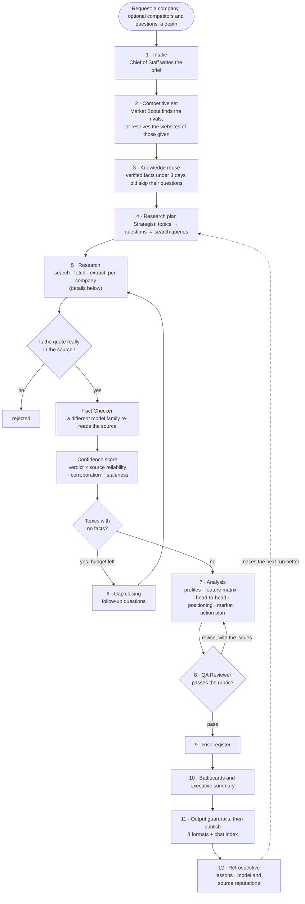

| Stage | Who | Model or code | Output |
|---|---|---|---|
| 1 Intake | Chief of Staff | model | Brief: industry, official website, focus areas |
| 2 Competitive set | Market Scout | model + search | Up to 3, 4 or 6 competitors by depth (or up to 8 you name), each grounded in search results |
| 3 Knowledge reuse | Knowledge base | code | Recent verified facts, so their questions are skipped |
| 4 Research plan | Research Strategist | model | Questions and queries per company and topic (6 topics at `quick`, 9 at `standard`, 11 at `deep`) |
| 5 Research | Research Lead + 4 specialists, Security Officer | model + code | Facts with a source URL and a verbatim quote |
| 5 Verification | Validation Engine, Fact Checker | code, then model | Grounded, verified facts with confidence scores |
| 6 Gap closing | Research Strategist | model | Follow-up questions for empty topics (1 round at `standard`, 2 at `deep`) |
| 7 Analysis | Data Analyst, Strategy Analyst | model | Profiles, pricing tables, feature matrix, head-to-head, positioning map, market trends, action plan |
| 8 QA | QA Reviewer | model (different family from the writer) | Rubric score; sends weak analysis back with concrete issues (1 revision at `standard`, 2 at `deep`) |
| 9 Risk | Chief Risk Officer | model + code | Risk register, including research-quality and compliance risks |
| 10 Enablement | Enablement Writer, CEO | model | Sales battlecards, executive summary |
| 11 Publishing | Publishing Desk, Visualization Designer | code | HTML report, PDF, deck, report site, Markdown, JSON, charts, chat index |
| 12 Learning | Retrospective Analyst, Playbook Curator | model + code | New lessons for the roles that failed, updated reputations |

### Inside one research round (per company)

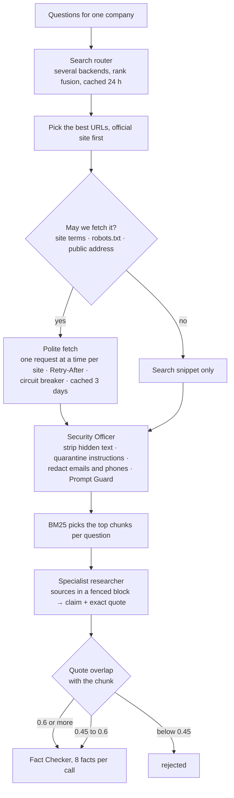

Near matches (0.45 to 0.6) reach the Fact Checker with a confidence penalty. A page that only renders with
JavaScript may be read through Jina Reader or Parallel, but only when the site itself has not refused.

### How a model is picked for each call

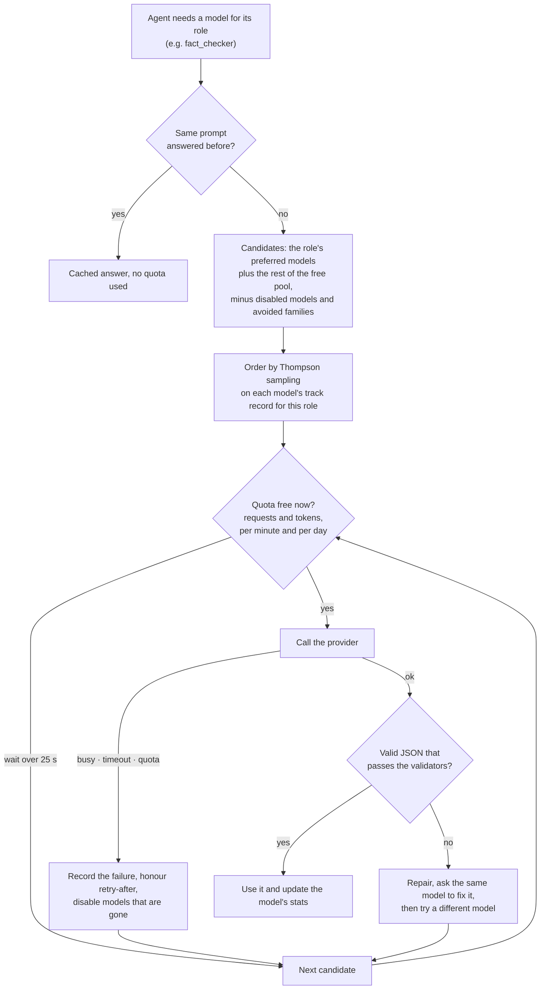

The validators include a banned-jargon list, which is why a run log can show *invalid output (replace jargon with
specifics: seamless)*: the answer was rejected and rewritten, not lost.

### A real run in numbers

From `resurge run "Linear" --depth quick` on 2026-11-21 (Groq, Gemini and OpenRouter free keys): 4 companies, 39
searches, 24 pages, 38 successful model calls, 161K tokens, quality 90.3/100, $0.00 (about $1.09 on a paid frontier API).

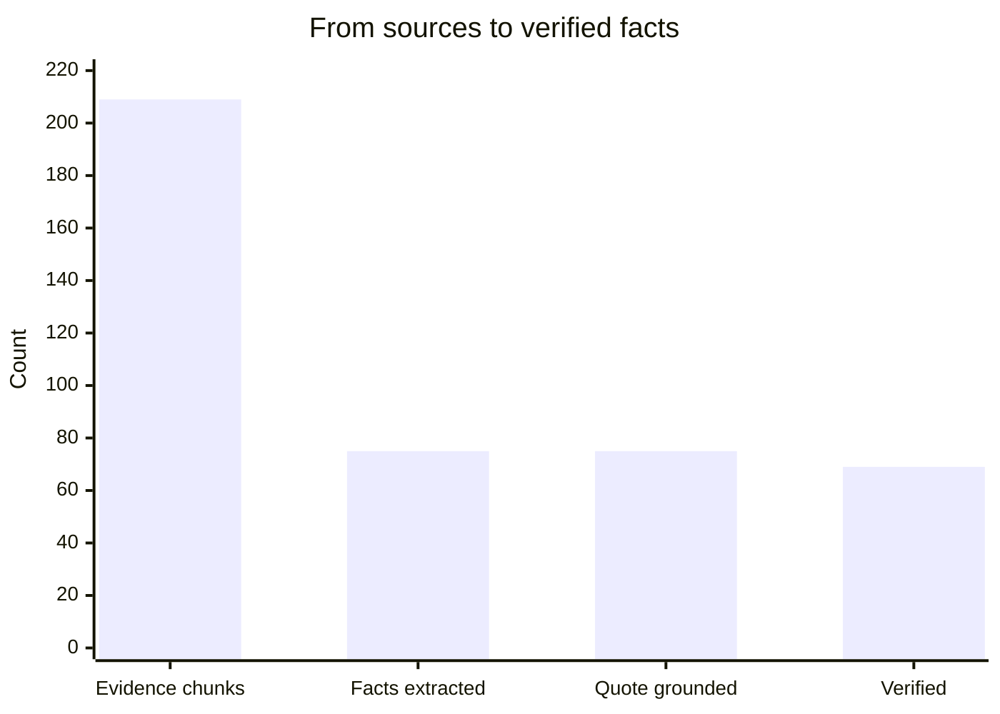

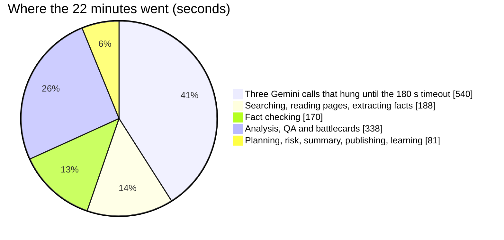

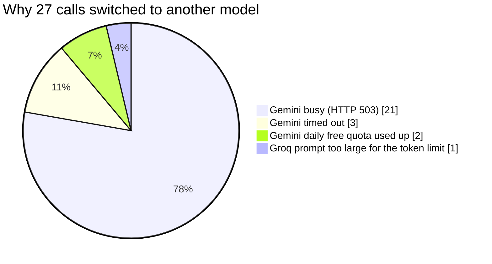

Successful calls by provider: Groq 14, OpenRouter 12, Gemini 12. A failover is a call that moved to the next model;
none of them lost work. The biggest speed win available is a shorter per-call timeout for slow providers
(`RESURGE_LLM_TIMEOUT_S`, default 180).

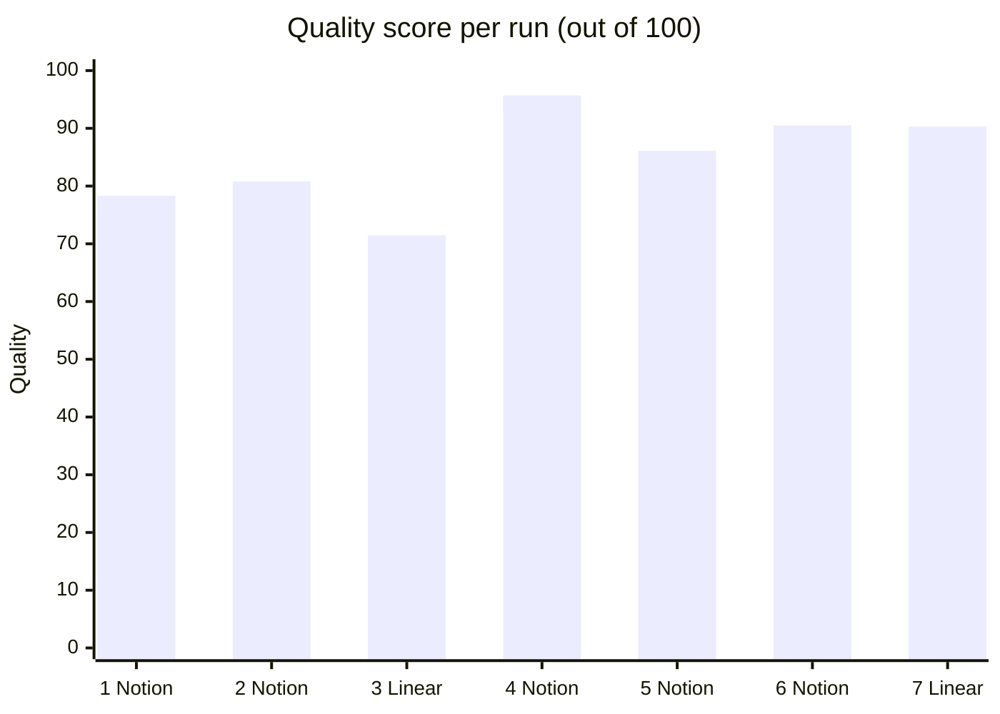

Runs 1 to 3 used only a local 7B model with no API keys; runs 4 to 7 used free cloud keys.

---

## The company

| Department | Agent | Job | Default free models (first choice → fallbacks) |
|---|---|---|---|
| Executive Office | **CEO** | Narrative, executive summary, sign-off | Gemini 3.8 Flash → Nemotron-3-Ultra 550B → gpt-oss-120b |
| | **Chief of Staff** | Turns the request into a precise brief | gpt-oss-20b (Groq) → Gemini 3.1 Flash-Lite → Gemma-4-26B |
| Finance | **CFO** *(code)* | Per-run budgets, quota reserve, cost accounting | — 0 tokens |
| Infrastructure | **CTO / Model Router** *(code)* | Quota-aware routing, failover, learning | — 0 tokens |
| Strategy & Planning | **Market Scout** | Discovers & qualifies the competitive set | gpt-oss-120b → Gemini Flash-Lite → Qwen3.8 |
| | **Research Strategist** | Dimensions, questions, queries, sources; closes gaps | Qwen3.8-27B → gpt-oss-120b |
| Research | **Product & Pricing Researcher** | Products, features, pricing, positioning | Gemini 3.5 Flash-Lite → Gemma-4-31B |
| | **Market & Funding Researcher** | Funding, news, go-to-market, hiring | Gemma-4-31B → Gemini 3.1 Flash-Lite |
| | **Voice-of-Customer Researcher** | Reviews, community sentiment, segments | gpt-oss-20b → Gemma-4-26B |
| | **Technology Researcher** | Integrations, APIs, AI, open source | Mistral Small → Gemini 3.1 Flash-Lite |
| Quality Assurance | **Validation Engine** *(code)* | Schema, citation-integrity, quote-grounding, coverage gates | — 0 tokens |
| | **Fact Checker** | Claim ⇄ source entailment, **different model family** | Qwen3.8-27B → Gemma-4-31B → gpt-oss-120b (NIM) |
| | **QA Reviewer** | Rubric scoring, sends work back for revision | Nemotron-3-Ultra → gpt-oss-120b |
| Analysis | **Data Analyst** | Profiles & pricing tables from verified facts | Gemini 3.5 Flash-Lite → gpt-oss-120b |
| | **Strategy Analyst** | Feature matrix, head-to-head vs the client, positioning, market changes, gaps, action plan | gpt-oss-120b → Gemini 3.6 Flash → Nemotron |
| Risk Office | **Chief Risk Officer** | Competitive, market, research-quality, compliance risks | Nemotron-3-Ultra → Qwen3.8 → gpt-oss-120b |
| | **Security & Compliance Officer** *(code + optional ML)* | Prompt-injection screening, PII redaction, robots.txt / site-terms enforcement | deterministic; Llama Prompt Guard 2 (Groq, free) for borderline text |
| Design & Comms | **Enablement Writer** | Sales battlecards & objection handling | Mistral Medium → Gemini 3.6 Flash → gpt-oss-120b |
| | **Visualization Designer** *(code)* | Charts | — |
| | **Publishing Desk** *(code)* | HTML report, PDF, deck, Markdown, JSON, Sheets, alerts | — |
| Learning & Development | **Retrospective Analyst** | Turns failures into lessons (ACE reflector) | gpt-oss-120b → Nemotron |
| | **Playbook Curator** *(code)* | Dedupes, caps, prunes lessons; updates reputations | — |

`resurge org` prints this table with the models each role would route to **right now**, given your keys, quotas and
learned performance. Routing lives in [`config/models.yaml`](config/models.yaml). Every department prefers a different
model family, and the router adds the rest of the free pool plus local fallbacks. How the departments hand work to
each other is in [the workflow](#the-workflow-start-to-finish).

## Deliverables (all free formats)

| File | What it contains |
|---|---|
| `report.html` | **The main report: one long page** (works offline, light/dark, phone-friendly, prints well). Summary and key findings, By the numbers with a company scorecard (threat, capabilities, cheapest plan, evidence, praise against complaints, latest move), landscape, features, pricing and cost by team size, positioning, a section per company with its own scorecard and what the evidence covers, head to head, SWOT, market and a timeline of moves, an action roadmap (now / next / later), risks, battlecards, how the research was done (searches → pages → claims → verified) and the evidence. Citations are numbered links to the exact quote and source. |
| `site/` | A multi-page version of the report; the web app uses its **Ask the research** page (chat with cited answers). |
| `report.pdf` | **The complete report as one document** (A4, about 25–40 pages): cover, clickable contents and bookmarks, About the company (what it is, founding, size, main businesses and products, what the report covers), executive summary with answers to your questions, **By the numbers** (the headline figures: cheapest plan, feature leader, biggest threat, moves tracked, quick wins and more), action plan with an impact/effort chart, market and a timeline of recent moves, pricing with team costs, feature grid, a full chapter per competitor (profile, strengths, what customers say, head-to-head, battlecard), risks, method and quality, and appendices with every verified fact (exact quote and source), all sources and the claims that failed verification. Citation numbers link to the evidence. Older runs: `resurge publish <run> --formats pdf`. |
| `report.pptx` | Consulting-style deck with a cover, contents and section dividers; slide titles state the finding ("Blinkit is the biggest threat to Swiggy") and chart slides carry a short "What it shows" panel. Slides: executive summary, By the numbers, landscape, capabilities at a glance, feature matrix, pricing and cost by team size, positioning map, what customers say, profile and head-to-head per competitor, moves over time, where to act first, action plan, risk heatmap, battlecards, methodology & sources. Citations are in speaker notes. Opens in PowerPoint, Keynote and Google Slides. |
| `report.md`, `report.json` | A diff-friendly Markdown copy, and the full report as data (`resurge publish` and the chat index read it) |
| `charts/*.png` | Pricing, cost by team size, feature heatmap, capabilities confirmed, positioning map, competitor moves over time, what customers say, where to act first (impact/effort), risk heatmap, coverage, evidence by source type, verification funnel, threat levels, model usage. A chart is skipped when the run has no data for it. |
| Google Sheets | `--sheets` (service account): one worksheet per table (competitors, pricing, features, facts, risks, …) |
| Slack / Discord / webhook | `--notify`: headline, findings, threats, quality score |

Two of the charts, from `resurge demo` (fictional companies). Prices come only from cited facts; a price no fact
contains is left off the chart.

<p>
  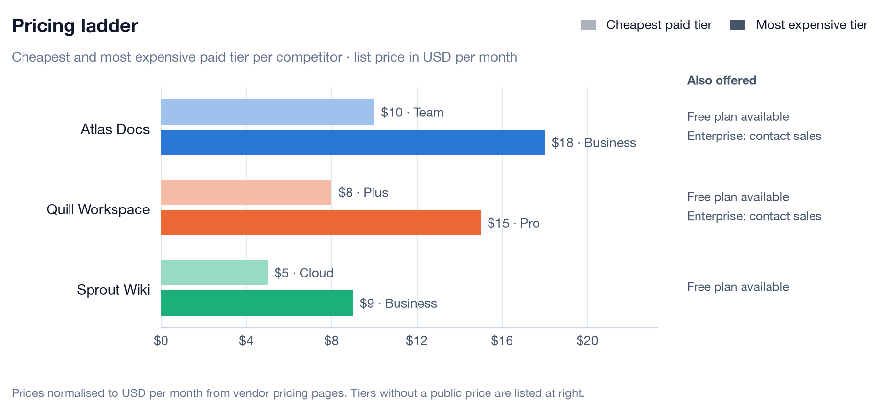
  
</p>

## Validation (the part that makes it trustworthy)

1. **No source, no claim.** Researchers must return `evidence_id` plus a **verbatim quote** for every fact.
2. **Quote grounding (code, 0 tokens).** The quote must literally appear in the cited chunk (shingle overlap ≥ 0.6).
   Near-matches (0.45–0.6, typical of paraphrasing small models) go to the verifier with a confidence penalty, and
   anything lower is rejected before any LLM sees it. This catches invented numbers and wrong-company claims cheaply.
3. **Cross-family fact checking.** The Fact Checker uses a different model family than the extractor (e.g. Gemma
   extracts, Qwen verifies), so the two are unlikely to share the same mistake. Verdicts are
   supported / partial / unsupported / contradicted, and small corrections are applied.
4. **Entity disambiguation.** Each company's identity comes from its official homepage title and official redirects
   (e.g. notion.so ↔ notion.com). Researchers and the Fact Checker see it, so a namesake (e.g. *coda.co*, a payments
   company, vs *coda.io*) is rejected. A deterministic namesake-domain penalty backs this up. Mis-filed facts are
   re-filed to the right dimension.
5. **Confidence model.** Confidence combines the verdict, the **learned** reliability of the source domain, corroboration
   from other independent domains, and a staleness penalty for fast-changing data (pricing, funding, headcount). It also
   flags **numeric conflicts**, such as two prices for one plan.
6. **Citation integrity.** Analysts see only verified facts. Unknown fact IDs are stripped, uncited insights are labelled
   *inferred*, and **any price that no cited fact contains is removed from charts**.
7. **QA gates with revision loops.** A rubric reviewer scores evidence, specificity, consistency, coverage and
   actionability. A *revise* verdict sends the analysis back with the concrete issues.
8. **Honest risk register.** Coverage gaps, single-source findings, stale data, conflicts, high rejection rates and the
   data-use terms of the free tiers used are reported as research-quality and compliance risks.

## Security & compliance (no blocks, nothing illegal, injection-resistant)

* **Polite, lawful crawling, never evasion.** Honest bot identity, robots.txt (RFC 9309) always on, `Crawl-delay`,
  one request at a time per site, `Retry-After` back-off and a circuit breaker. Refusals (403/451/robots) are final.
  No proxies, CAPTCHA solving, fingerprint spoofing, logins or paywall bypass. Sites whose terms forbid scraping are
  snippet-only, and unofficial search-engine scraping is off by default.
* **Prompt-injection defence in depth.** Tool-less agents (least privilege), sanitisation of hidden characters and
  instruction-like text, quarantine of hostile chunks, nonce-fenced "spotlighting" of evidence, rejection of
  instruction-like "facts", and an optional free Prompt Guard classifier. Every fact still needs a verbatim grounded
  quote and cross-family verification.
* **Guardrails on what people ask and what models answer.** Requests and chat questions pass rules, Llama Prompt
  Guard 2 and gpt-oss-safeguard-20b with a written acceptable-use policy (no crime, espionage, private people, fake
  reviews). Answers and reports are checked for prompt leaks (canary token), API keys, personal data and instruction
  residue. Details: [`src/resurge/guardrails.py`](src/resurge/guardrails.py).
* **Privacy & safety of outputs.** E-mails and phone numbers are redacted before storage or LLM calls. `resurge purge`
  handles retention. Deliverables are hardened against spreadsheet formula injection, XSS (strict CSP), unsafe links
  and chat mass-mentions.

### Guardrails, layer by layer

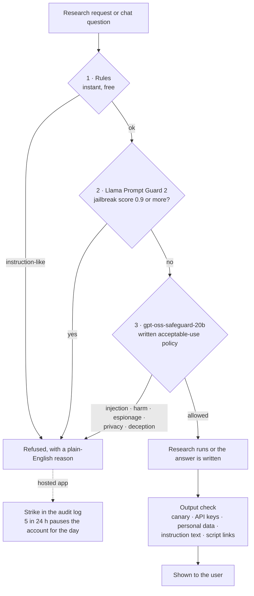

`RESURGE_GUARDRAILS`: `strict` (hosted default) refuses when the policy model cannot run, `on` (local default) falls back
to the rules, `off` skips the model layers. A busy safety model hands over to another free model after 2 seconds.

Full policy: [`docs/COMPLIANCE.md`](docs/COMPLIANCE.md). Each report's methodology section states the run's security
counts.

## Self-improvement (four feedback loops)

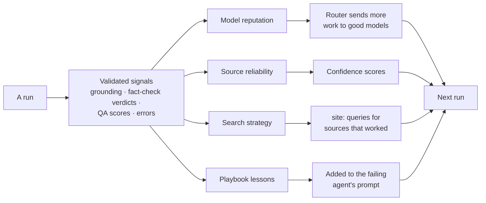

| Loop | Signal (validated, not self-graded) | Effect next run |
|---|---|---|
| Model reputation | per (role, model): JSON validity, share of facts that survive grounding and verification, QA scores | Router uses Thompson sampling over these stats, so better models get more traffic and new ones still get explored |
| Source reputation | per domain: supported vs unsupported verdicts | Bayesian reliability feeds confidence scores |
| Research strategy | which domains yield verified facts for each dimension | Strategist adds `site:` queries for proven sources |
| Playbooks (ACE, ICLR 2026) | Reflector reads concrete failures (rejected facts, QA issues, gaps, errors) | Curator stores ≤30-word lessons **only for roles that actually failed this run**, deduplicated and capped at 12 per role. Helpful/harmful counters are tied to run-quality deltas. Retirement is **evidence-gated**: an LLM's opinion alone cannot delete a lesson with a good track record |

`resurge learn` shows the playbook, the model leaderboard, source reputation and the quality trend. The dashboard has
the same data. ACE's known weakness is learning from unreliable signals; here the validators supply the outcome
signal.

## Staying free: model strategy

| Provider | Free tier (researched Nov 2026; limits change, the router also learns them live) | Best used for |
|---|---|---|
| Groq | No card. 30 RPM / 1K RPD / 8K TPM per chat model (gpt-oss-120b, gpt-oss-20b, Qwen3.8; the Llama models were retired 2026-08-16) | Fast short calls: planning, verification, QA |
| Google AI Studio | No card. Gemini 3.x Flash ~5 RPM / ~20 RPD; Flash-Lite ~15 RPM / ~500 RPD; Gemma 4 ~15 RPM / ~1.5K RPD; 1M context | Long-context extraction (Flash-Lite, Gemma), top-quality writing (3.8 Flash, sparingly) |
| OpenRouter `:free` | No card. 20 RPM, **50 requests/day shared** (1K/day after a one-time $10 top-up) | Rare high-value reasoning (Nemotron-3-Ultra 550B) |
| Mistral | Free plan, restrictive per-model limits | Writing, extraction |
| NVIDIA NIM | Free dev access ~40 RPM | Extra capacity for gpt-oss-120b, Llama-3.3-70B |
| Cloudflare Workers AI | 10K neurons/day | Small overflow |
| Cerebras | Trial credits | Very fast overflow |
| Ollama (local) | Unlimited, private | Last-resort fallback; `--local` for sensitive work |

> GitHub Models was reportedly retired in July 2026, so it is not included. Gemini's free tier and Mistral's free plan
> may use prompts for training. `--private` excludes such providers.

## Cost & performance optimisations built in

1. **Deterministic where possible.** Validation, grounding, confidence, routing, budgeting, charts and publishing are
   code, not LLM calls.
2. **Retrieval before reasoning.** Pages are chunked and BM25-ranked locally, and each researcher sees only the top
   chunks for its questions (≈3.5K tokens instead of 50K+ per page set).
3. **Tiered models per role.** Small models do classification, mid-size models do extraction, and the scarce frontier
   free quota goes to synthesis.
4. **Quota-aware routing.** Sliding-window RPM/TPM and persistent RPD/TPD counters per model and per provider. The day
   boundary follows each provider's reset timezone (Gemini uses Pacific time).
5. **Never idle on one provider.** If a slot is more than 25s away, the router moves to the next candidate; it only
   waits patiently when every model is busy.
6. **Learns provider quirks.** It disables dead or forbidden models, drops unsupported `response_format`, system prompts
   and `reasoning_effort` per model, persistently, and reads `retry-after` and `x-ratelimit-*` headers.
7. **Three caches.** LLM responses (keyed by role and prompt, model-agnostic), search results (24h) and pages (3 days),
   all in SQLite.
8. **Knowledge-base reuse.** Verified facts younger than N days (`--reuse-days`, default 3) are reused and those
   questions are skipped, which makes incremental monitoring cheap.
9. **Compact structured output.** A TypeScript-like schema hint replaces verbose JSON Schema. Then come forgiving
   parsing, repair, self-repair by the same model, and finally a different model.
10. **Batching.** 8 facts per verification call and 2 battlecards per call.
11. **Stable prompt prefixes.** Identity, standards and playbook come first so provider prompt caches hit; Groq does
    not count cached tokens toward its limits.
12. **CFO budgets.** `quick`/`standard`/`deep` presets, a reserve that keeps analysis and reporting alive, and honest
    degradation (e.g. "grounded but not LLM-verified") instead of failure.
13. **Cost transparency.** Every run reports tokens and what they would have cost on a paid frontier API ($3/$15 per
    M tokens, configurable). Actual cost is $0.

## Integrations

* **MCP server.** `resurge mcp` (stdio) or `resurge mcp --transport http`. Tools: `research_competitors` (streams stage
  progress), `discover_competitors`, `list_runs`, `get_report_section`, `get_battlecard`, `search_knowledge_base`. For
  Claude Desktop, see [`config/claude_desktop_config.example.json`](config/claude_desktop_config.example.json).
* **MCP client.** Researchers can search through *any* MCP server. Parallel's free hosted MCP is built in, and you can
  add Brave/Exa/Firecrawl/SearXNG MCP servers in `config/mcp_servers.yaml` (see the `.example`).
* **Google Sheets.** Create a Google Cloud service account (free), download its JSON key, then set
  `GOOGLE_SERVICE_ACCOUNT_FILE` (and optionally `GOOGLE_SHEETS_SHARE_WITH`). Run with `resurge run ... --sheets` or
  `resurge publish <run_id> --sheets`.
* **Slack / Discord / any webhook.** Use `--notify`.
* **Competitor monitoring.** `resurge watch` diffs each run against the previous one. Rephrasings are ignored, and numeric changes are reported as **Changed** (e.g. *Pro plan $10 → $12*) next to genuinely **New** facts.
* **GitHub Actions (free scheduler).** [`.github/workflows/resurge-watch.yml`](.github/workflows/resurge-watch.yml)
  runs weekly monitoring, caches the company's memory between runs and uploads the deliverables.
* **Web dashboard.** `resurge ui` launches engagements, shows the live activity feed per department, and lists
  deliverables, the org chart, learning and providers.

## Hosted web app (log in, type a company)


`resurge serve` runs the public website: a landing page that explains what Resurge is, how to use it and how it works
(with a flowchart), and the app behind it, where people create an account, type a company or its website and get the
report and chat, with nothing to install. While an analysis runs, its page shows a running clock, a progress bar,
the seven steps (each with how long it took and what it found), live counts of pages read, facts verified and AI
calls, and the agents' activity as it happens ([`web/progress.py`](src/resurge/web/progress.py) turns the event log
into that view and keeps server file paths out of it).

The website is a React app built with Next.js ([`frontend/`](frontend)) and exported as static files that the same
Python process serves next to its JSON API. One origin carries the session cookie, the Origin checks and a strict
Content-Security-Policy: each page's few inline scripts are allowed by their SHA-256 hash, nothing else inline runs.
A web address typed as the company (`https://www.linear.app/pricing`) keeps only the company's main site
(`linear.app`); logins, ports, IP addresses and internal names are refused. Build the site once with
`cd frontend && npm install && npm run build` (the Docker image does this itself). For live editing, run
`npm run dev` next to `RESURGE_ALLOWED_ORIGINS=http://localhost:3000 resurge serve`.

When an analysis finishes, its page (also reached from "View analysis" on the dashboard) offers the report, the PDF, the slide deck and the Ask page.

Your free API keys stay on the server; daily limits per account, per network and site-wide, a run queue, throttled
log-in, optional Cloudflare Turnstile, guardrails that pause repeat offenders and owner-only reports protect them.
Ships as a Docker image with optional automatic HTTPS (Caddy) or a Cloudflare Tunnel. Setup:
[docs/DEPLOY.md](docs/DEPLOY.md).

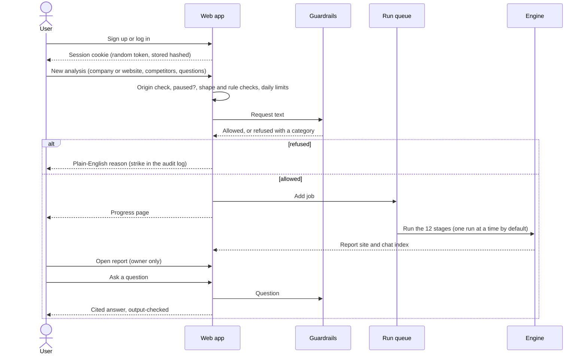

## Ask your research (RAG chat)

Every finished run is indexed for questions in plain English - *"What would Asana cost for 50 seats?"*,
*"What do customers complain about in ClickUp?"*, *"How do we win against Airtable?"* Answers come only from that
run's verified facts and cite their sources; questions the research doesn't cover get an honest "not covered".

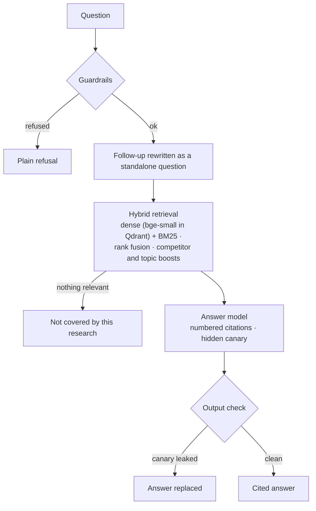

- Ask in the report site (**Ask the research** page, via `resurge ui`), in the terminal (`resurge chat`) or from any
  MCP client (`ask_research` tool).
- Vector store: **Qdrant**. Add `QDRANT_URL` and `QDRANT_API_KEY` to `.env` to use a free Qdrant Cloud cluster;
  without them a local embedded Qdrant is used automatically. Embeddings run locally (FastEmbed) - free and private.
- Install with `pip install -e '.[rag]'`. Details: [docs/RAG.md](docs/RAG.md).

## CLI

```
resurge run TARGET [-c a,b] [--depth quick|standard|deep] [--focus pricing,AI] [-q "question"] [--local] [--private]
                   [--providers groq,gemini] [--sheets] [--notify] [--reuse-days 3] [-v]
resurge discover TARGET            # competitive set only
resurge watch TARGET [--interval-hours 24]   # monitoring + "what changed"
resurge doctor [--ping]            # keys, live models, quota used today, search backends
resurge models [--role fact_checker]
resurge org | runs | learn | kb "pricing"
resurge publish RUN_ID [--sheets] [--notify]
resurge chat [RUN_ID]              # ask questions about a run (RAG over its verified facts)
resurge index [RUN_ID]             # (re)build the chat index for one or all runs
resurge purge [--knowledge --learning --history --reports]   # data retention
resurge mcp | ui | serve | init | demo   # serve = hosted multi-user web app
```

## Risks & limitations (read before relying on output)

* **Free tiers change often.** Limits and model line-ups move monthly. `resurge doctor` checks reality, the router
  adapts, and `config/models.yaml` is the single place to edit.
* **Data use.** Some free tiers may train on prompts. Don't put confidential strategy in briefs unless you use
  `--private` or `--local`.
* **Public web only, no circumvention.** robots.txt and site terms are always honoured. Logged-in, paywalled and
  "no automated access" sites are never fetched, and a refusal is final (search snippets at most). Some facts will
  therefore be missing. Optional official search keys (Tavily, Brave, Exa, …) improve coverage legitimately.
* **"Unknown" ≠ "no".** The feature matrix keeps *unknown* when sources are silent. Read coverage and confidence
  before drawing conclusions.
* **Verification is strong but not perfect.** Two models can still agree on a misreading. Decision-critical numbers
  (prices, funding) should be confirmed on the linked official page.
* **Local-only quality.** A 7B local model works but extracts fewer facts than the cloud free tiers.

## Project layout

```
config/models.yaml            providers, models, quotas, role routing (edit me)
config/compliance.yaml        sites that are never fetched (terms forbid it)
src/resurge/
  schemas.py                  data contracts between departments
  llm/                        registry + discovery, rate limiter, gateway (routing, failover, JSON), doctor
  agents/                     org chart + one module per department
  pipeline/                   run context (blackboard) + COO orchestrator
  tools/                      search backends, router (RRF fusion), fetcher, compliance, safe HTTP, MCP bridge
  outputs/                    html report, pdf, pptx, report site (multi-page), charts, md, json, Sheets, alerts
  rag/                        chat over a run: chunking, local embeddings, Qdrant (cloud or embedded), answers
  security.py                 web-content sanitising, quarantine, nonce fences, PII redaction
  input_guard.py              shape and rule checks for requests and chat questions
  guardrails.py               Prompt Guard 2 + policy model, output checks, report cleaning
  budget.py, cache.py         CFO budgets, cache keys
  storage.py                  SQLite: caches, runs, events, quotas, reputations, KB, playbook, scores
  web/app.py                  local dashboard (resurge ui)
  web/hosted.py, accounts.py  hosted app (resurge serve): JSON API, website with per-page CSP, accounts, limits, queue
  web/progress.py             live progress for the website: steps, counts and a clean activity feed
  mcp_server.py, cli.py
frontend/                     the website: React + Next.js, exported as static files (npm run build -> frontend/out)
  app/                        pages: landing, sign-up, log-in, dashboard, analysis, account, admin, privacy
  components/                 header, footer, flowchart, forms and page views
  lib/                        API client, types, time formatting (shown in each viewer's time zone)
tests/                        offline unit + end-to-end tests (scripted LLM), optional live tests
Dockerfile, docker-compose.yml, deploy/Caddyfile   hosting (see docs/DEPLOY.md)
docs/                         DEPLOY, COMPLIANCE, RAG, RESEARCH, images
```

## Tests

```bash
python -m pytest -q                              # offline: core engine, tools, outputs, full pipeline, web API
cd frontend && npm run build                     # type-checks and builds the website
RESURGE_LIVE_TESTS=1 python -m pytest -q -m live # live free search backends
```

## Live verification (November 2026)

Runs 1-3 ran with **no API keys at all**: free web search plus the local `qwen2.5:7b` model on a
16 GB laptop, about 15 minutes each, $0.00.

| Run | Brief | Result |
|---|---|---|
| 1 | Notion vs Coda, ClickUp | Exposed real-world bugs (namesake company *coda.co* vs *coda.io*, single-model dead end, skipped fact checker), all fixed with regression tests |
| 2 | Same brief, after fixes | Quality 81/100, coverage 100%, fact checker rejected 6/22 claims (incl. a ClickHouse article misattributed to ClickUp) |
| 3 | "Linear", competitors auto-discovered | Market Scout picked Jira and Plane; quality 72/100, QA review 8/10 |
| 4 | "Notion", free cloud keys (Groq + Gemini) | Quality 96/100: 64 of 66 facts verified, every quote matched its page, coverage 100%, QA 8.3/10; 28 model calls across 10 free models, 13 minutes, $0.00 |

With free cloud keys (Groq, Gemini, OpenRouter) extraction and verification quality is much higher than with a 7B
local model. Runs 1-3 predate the stricter crawling policy; with it, restricted sites contribute search snippets only.

## Research notes

See [`docs/RESEARCH.md`](docs/RESEARCH.md) for the provider, search-API and self-improvement research behind these
choices, with sources.
