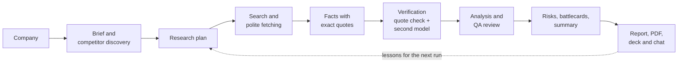
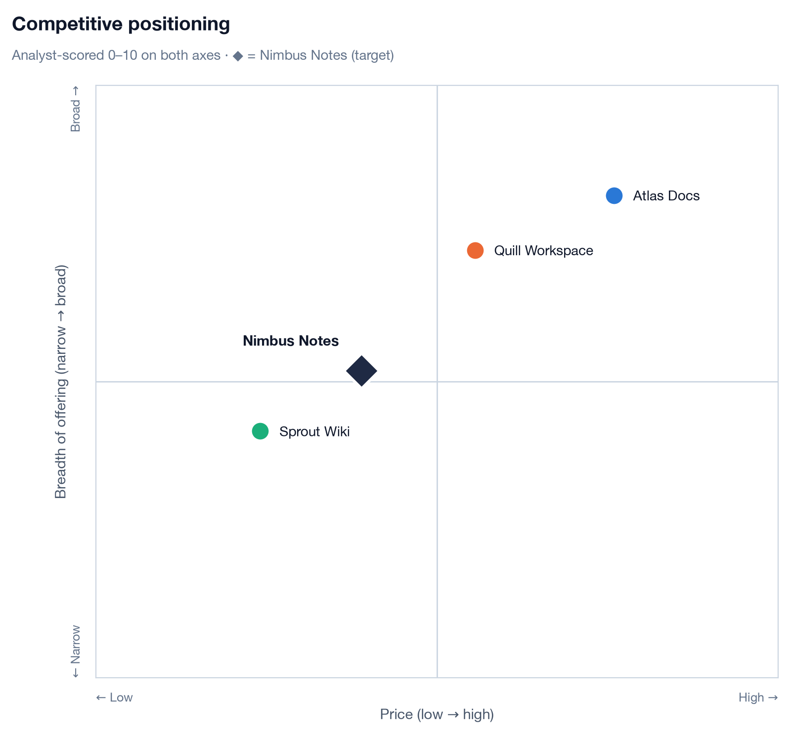
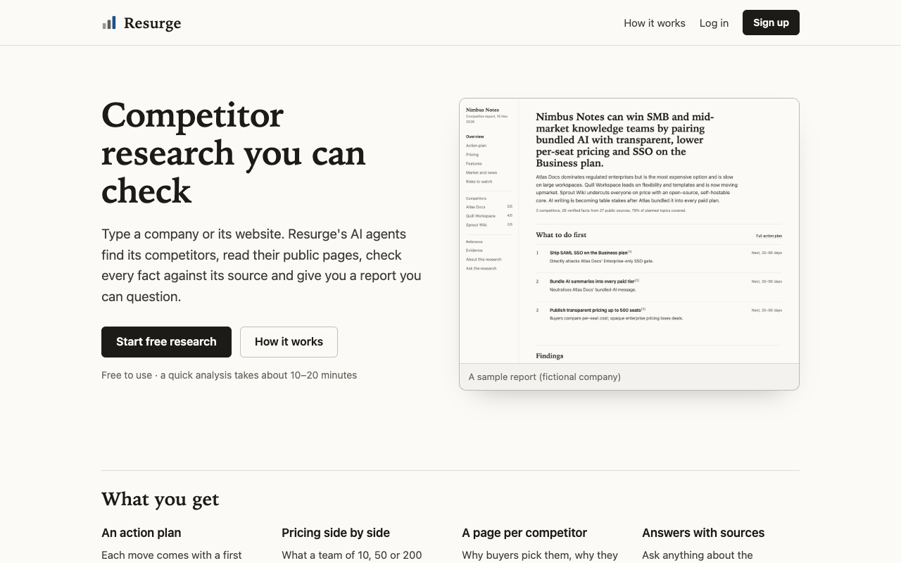

# Resurge

**Free, multi-agent competitor research where every finding is tied to a source and checked by a second model.**

Give Resurge a company name. A team of 22 AI agents finds its competitors, researches them on the public web,
verifies every claim against its source, and delivers a report site, a PDF, a slide deck and a chat that answers
follow-up questions from the research. It runs entirely on free model tiers, so a report costs $0.

```bash
resurge run "Notion" --competitors "Coda,ClickUp,Confluence"
```


## Highlights

- **Evidence, not guesses.** Every fact carries a source link and a verbatim quote. Code confirms the quote appears on
  the page, then a model from a different family re-reads the source. Claims that fail never reach the report.
- **Costs nothing to run.** Calls are routed across the free tiers of Groq, Google AI Studio, OpenRouter, Mistral,
  NVIDIA NIM, Cloudflare and Cerebras, or a local Ollama model, with quota tracking, automatic failover and caching.
- **Organised like a consulting firm.** 22 agents in 10 departments (strategy, research, quality assurance, analysis,
  risk, communications and more) hand work to each other through validated contracts.
- **Built for decisions.** Pricing and cost by team size, a feature matrix, head-to-head comparisons, a positioning
  map, a risk register, sales battlecards and an action plan with first steps and owners.
- **Ask follow-up questions.** Each finished report becomes a chat that answers only from its verified facts, with
  citations, and says so when the research doesn't cover a question.
- **Polite and safe by design.** robots.txt and site terms are always honoured, web text is screened for prompt
  injection, and requests and answers pass layered guardrails.
- **Improves with every run.** Validated outcomes update model rankings, source reliability, search strategy and
  per-agent lessons.

## Quick start

Requires Python 3.11+. Node 20.9+ is needed only to build the website.

```bash
git clone https://github.com/LakshayJ17/resurge.git && cd resurge
python -m venv .venv && source .venv/bin/activate
pip install -e ".[web,rag]"

resurge init                        # creates .env and lists where to get free API keys
resurge doctor                      # checks your keys and search backends
resurge demo                        # sample deliverables with fictional data, no keys needed
resurge run "Linear" --depth quick  # competitors are found automatically
resurge ui                          # local dashboard at http://127.0.0.1:8765
```

**API keys.** One free key is enough to start: Groq, Gemini (Google AI Studio) or OpenRouter. More keys add
capacity and model variety, which strengthens cross-model checking. With no keys at all, run fully locally:
`ollama pull qwen2.5:7b`, then add `--local` (private and unlimited, but lower quality).

**Search** needs no keys: it uses Parallel's free hosted MCP server and the official Hacker News, Wikipedia and GitHub
APIs. Tavily, Exa, Jina, Serper, Brave or your own SearXNG are used automatically when their keys are set. Set
`RESURGE_CONTACT` so sites know who is crawling.

## How it works



1. **Brief and competitive set.** The Chief of Staff turns the request into a brief; the Market Scout finds the main
   competitors, or resolves the websites of the ones you name.
2. **Research.** The Research Strategist plans questions per company and topic. Four specialist researchers search,
   fetch pages politely and extract claims, each with a verbatim quote from its source.
3. **Verification.** Code rejects any quote that isn't on the page. A Fact Checker from a different model family
   re-reads the source, and each surviving fact gets a confidence score.
4. **Analysis.** Analysts build profiles, pricing tables, the feature matrix, head-to-head comparisons and an action
   plan from verified facts only. A QA Reviewer scores the work and sends weak sections back.
5. **Delivery.** The Risk Office, Enablement Writer and CEO add the risk register, battlecards and executive summary.
   The Publishing Desk builds every format and indexes the run for chat.
6. **Learning.** A retrospective turns this run's failures into lessons and updates model and source reputations.

Architecture, all 12 stages, model routing, the agent roster, validation, guardrails and self-improvement are
covered in **[docs/HOW_IT_WORKS.md](docs/HOW_IT_WORKS.md)**.

## What you get

| Output | Contents |
|---|---|
| Report site (`site/`) | A multi-page report: summary, competitors, pricing, features, market, risks, actions, sources, and an **Ask the research** chat page |
| `report.html` | The whole report on one page; works offline, light and dark, phone-friendly, prints well |
| `report.pdf` | The complete report as an A4 document (about 25 to 40 pages), with clickable contents, a chapter per competitor and every verified fact with its quote and source |
| `report.pptx` | A slide deck whose titles state the finding; citations in the speaker notes. Opens in PowerPoint, Keynote and Google Slides |
| `report.md`, `report.json` | A Markdown copy, and the full report as data |
| `charts/*.png` | Pricing, cost by team size, feature heatmap, positioning map, risk heatmap and more |
| Google Sheets, Slack, Discord | Optional, with `--sheets` and `--notify` |

Prices on charts come only from cited facts; a price no fact contains is left off.

<p>
  
  
</p>

## Ways to use it

| Interface | Start it with | Use it to |
|---|---|---|
| Command line | `resurge run`, `resurge chat` | Run analyses and ask questions from the terminal |
| Local dashboard | `resurge ui` | Launch runs, watch each department's live activity, browse reports, learning data and providers |
| Hosted web app | `resurge serve` | Let people sign up, type a company and get the report and chat, with nothing to install |
| MCP server | `resurge mcp` | Use Resurge from Claude Desktop or any MCP client |
| Monitoring | `resurge watch`, [GitHub Actions workflow](.github/workflows/resurge-watch.yml) | Re-run on a schedule and report what changed, such as a plan's price going from $10 to $12 |

### Hosted web app



`resurge serve` runs a public website: a landing page that explains Resurge, and the app behind it. People create an
account, type a company or its website, follow the analysis live (each step, pages read, facts verified and the
agents' activity) and then open the report, PDF, slides and Ask page. Your API keys stay on the server, protected by
daily limits per account, per network and site-wide, a run queue, login throttling and guardrails.

To build the website once: `cd frontend && npm install && npm run build`. It ships as a Docker image with automatic
HTTPS through Caddy; see **[docs/DEPLOY.md](docs/DEPLOY.md)**.

### Command reference

```
resurge run TARGET [-c a,b] [--depth quick|standard|deep] [--focus pricing,AI] [-q "question"] [--local] [--private]
                   [--providers groq,gemini] [--sheets] [--notify] [--reuse-days 3] [-v]
resurge discover TARGET                  # competitive set only
resurge watch TARGET [--interval-hours 24]   # monitoring + "what changed"
resurge chat [RUN_ID]                    # ask questions about a run
resurge publish RUN_ID [--formats pdf] [--sheets] [--notify]
resurge doctor [--ping]                  # keys, live models, quota used today, search backends
resurge models [--role fact_checker]
resurge org | runs | learn | kb "pricing"
resurge index [RUN_ID]                   # (re)build the chat index
resurge purge [--knowledge --learning --history --reports]   # data retention
resurge mcp | ui | serve | init | demo | admin EMAIL
```

## Trust and safety

- **Lawful, polite crawling.** An honest bot identity, robots.txt always on, `Crawl-delay`, one request at a time per
  site, `Retry-After` back-off and a circuit breaker. Refusals are final: no proxies, CAPTCHA solving, logins or
  paywall bypass. Sites whose terms forbid scraping contribute search snippets only.
- **Prompt-injection defence.** Hidden text is stripped, instruction-like text is quarantined, evidence is fenced
  with a random marker a web page can't predict, and agents have no tools they could be tricked into using.
- **Guardrails.** Requests and chat questions pass rules, Llama Prompt Guard 2 and a policy model with a written
  acceptable-use policy. Answers and reports are checked for prompt leaks, API keys and personal data.
- **Privacy.** Email addresses and phone numbers are redacted before storage or model calls; `resurge purge` handles
  retention. Reports use a strict Content-Security-Policy.

Full policy: [docs/COMPLIANCE.md](docs/COMPLIANCE.md).

## Limitations

- **Free tiers change often.** Limits and model line-ups move monthly. `resurge doctor` checks what's available,
  the router adapts, and [`config/models.yaml`](config/models.yaml) is the single place to edit.
- **Data use.** Some free tiers may train on prompts. Keep confidential strategy out of briefs, or use `--private`
  or `--local`.
- **Public web only.** Logged-in, paywalled and "no automated access" sites are never fetched, so some facts will be
  missing. Optional official search keys improve coverage.
- **"Unknown" isn't "no".** The feature matrix keeps *unknown* when sources are silent; check coverage and confidence
  before drawing conclusions.
- **Verification is strong, not perfect.** Two models can still agree on a misreading. Confirm decision-critical
  numbers, such as prices and funding, on the linked official page.
- **Local models extract less.** A 7B local model works, but finds fewer facts than the free cloud tiers.

## Project layout

```
config/            models, quotas and role routing (models.yaml); sites never fetched (compliance.yaml)
src/resurge/
  agents/          the org chart and one module per department
  pipeline/        orchestrator and the shared run context
  llm/             model registry, rate limiter, gateway (routing, failover, JSON repair)
  tools/           search backends, polite fetcher, compliance, safe HTTP, MCP client
  outputs/         report site, HTML, PDF, slides, charts, Markdown, JSON, Sheets, alerts
  rag/             chat over a run: chunking, local embeddings, Qdrant, cited answers
  web/             local dashboard and the hosted web app
  security.py, input_guard.py, guardrails.py   web-content screening and guardrails
frontend/          the website (React + Next.js, exported as static files)
tests/             offline unit and end-to-end tests, plus optional live tests
docs/              how it works, deployment, chat, compliance, research
```

## Development

```bash
pip install -e ".[web,rag,dev]"
python -m pytest -q                                # offline tests: engine, tools, outputs, pipeline, web API
cd frontend && npm run build                       # type-checks and builds the website
RESURGE_LIVE_TESTS=1 python -m pytest -q -m live   # live checks against the free search backends
```

## Documentation

| Document | Covers |
|---|---|
| [How it works](docs/HOW_IT_WORKS.md) | Architecture, the 12 stages, model routing, agents, validation, guardrails, self-improvement |
| [Deployment](docs/DEPLOY.md) | Hosting the web app with Docker and HTTPS |
| [Chat (RAG)](docs/RAG.md) | How questions are answered from a run's verified facts |
| [Compliance](docs/COMPLIANCE.md) | Crawling, data protection and prompt-injection policy |
| [Research](docs/RESEARCH.md) | The provider and search research behind the design, with sources |
