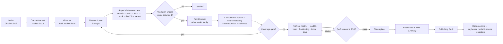

# Resurge — a free, self-improving AI competitive-intelligence company

Resurge runs competitor research the way a consulting firm would: **22 specialised agents in 10 departments**
(Executive Office, Strategy, Research, QA, Analysis, Risk, Communications, Learning, plus a CTO model-router and a
CFO budget office) hand work to each other through schema-validated contracts. Every claim is tied to a source URL and a
verbatim quote. Each claim is fact-checked by a *different model family* than the one that extracted it, then scored
for confidence. The results are published as a **PowerPoint deck, Excel workbook, HTML report, Markdown, JSON/CSV,
Google Sheets and Slack/Discord alerts**.

The system **costs $0 to run.** It routes every task across the free tiers of Groq, Google AI Studio (Gemini / Gemma),
OpenRouter `:free`, Mistral, NVIDIA NIM, Cloudflare, Cerebras (trial credits) and local Ollama. Rate-limit-aware
failover, caching and a knowledge base keep it inside quota. It also **gets better every run**: validated outcomes
update model reputations, source reliability, search strategy and ACE-style playbooks injected into each agent's
prompt.

```
resurge run "Notion" --competitors "Coda,ClickUp,Confluence" --depth standard
```

---

## Quick start

```bash
cd resurge
uv venv && uv pip install -e ".[web,rag,gsheets,dev]"  # or: python -m venv .venv && pip install -e ".[web,rag]"
source .venv/bin/activate
resurge init        # creates .env and lists where to get FREE keys (~1 minute each, no card)
resurge doctor      # verifies keys against each provider's live /models list, shows search backends
resurge demo        # instant sample deliverables (fictional data, no keys)
resurge run "Linear" --depth quick                # auto-discovers competitors
resurge ui          # dashboard at http://127.0.0.1:8765
```

One free key is enough to start: **Groq**, **Gemini (AI Studio)** or **OpenRouter**. More keys add more capacity and more
model diversity, which helps cross-model verification. **No key at all?** `ollama pull qwen2.5:7b` and run with `--local`.
That is 100% private and unlimited, but lower quality.

Search needs **no keys** and uses only sanctioned access: Parallel's free hosted MCP server (web and news) plus the
official Hacker News, Wikipedia and GitHub APIs. Official search APIs with free tiers (Tavily, Exa, Jina, Serper,
Brave, your own SearXNG) are picked up automatically when their keys are present and noticeably improve coverage.
Unofficial search-engine scraping (`ddgs`) and Google News RSS are **off** unless you opt in with
`RESURGE_ALLOW_UNOFFICIAL_SEARCH=1` (see [compliance](docs/COMPLIANCE.md)). Set `RESURGE_CONTACT` so sites know who is
crawling.

---

## The company

| Department | Agent | Job | Default free models (first choice → fallbacks) |
|---|---|---|---|
| Executive Office | **CEO** | Narrative, executive summary, sign-off | Gemini 3.8 Flash → Nemotron-3-Ultra 550B → gpt-oss-120b |
| | **Chief of Staff** | Turns the request into a precise brief | Llama-3.1-8B (Groq) → Gemini 3.1 Flash-Lite |
| Finance | **CFO** *(code)* | Per-run budgets, quota reserve, cost accounting | — 0 tokens |
| Infrastructure | **CTO / Model Router** *(code)* | Quota-aware routing, failover, learning | — 0 tokens |
| Strategy & Planning | **Market Scout** | Discovers & qualifies the competitive set | gpt-oss-120b → Gemini Flash-Lite → Qwen3.8 |
| | **Research Strategist** | Dimensions, questions, queries, sources; closes gaps | Qwen3.8-27B → gpt-oss-120b |
| Research | **Product & Pricing Researcher** | Products, features, pricing, positioning | Gemini 3.5 Flash-Lite → Gemma-4-31B |
| | **Market & Funding Researcher** | Funding, news, go-to-market, hiring | Gemma-4-31B → Gemini 3.1 Flash-Lite |
| | **Voice-of-Customer Researcher** | Reviews, community sentiment, segments | gpt-oss-20b → Gemma-4-26B |
| | **Technology Researcher** | Integrations, APIs, AI, open source | Mistral Small → Gemini 3.1 Flash-Lite |
| Quality Assurance | **Validation Engine** *(code)* | Schema, citation-integrity, quote-grounding, coverage gates | — 0 tokens |
| | **Fact Checker** | Claim ⇄ source entailment, **different model family** | Llama-3.3-70B → Qwen3.8 → gpt-oss-120b (NIM) |
| | **QA Reviewer** | Rubric scoring, sends work back for revision | Nemotron-3-Ultra → gpt-oss-120b |
| Analysis | **Data Analyst** | Profiles & pricing tables from verified facts | Gemini 3.5 Flash-Lite → gpt-oss-120b |
| | **Strategy Analyst** | Feature matrix, head-to-head vs the client, positioning, market changes, gaps, action plan | gpt-oss-120b → Gemini 3.6 Flash → Nemotron |
| Risk Office | **Chief Risk Officer** | Competitive, market, research-quality, compliance risks | Nemotron-3-Ultra → Qwen3.8 → MiniMax-M2.7 |
| | **Security & Compliance Officer** *(code + optional ML)* | Prompt-injection screening, PII redaction, robots.txt / site-terms enforcement | deterministic; Llama Prompt Guard 2 (Groq, free) for borderline text |
| Design & Comms | **Enablement Writer** | Sales battlecards & objection handling | Mistral Medium → Gemini 3.6 Flash → Llama-3.3-70B |
| | **Visualization Designer** *(code)* | Charts | — |
| | **Publishing Desk** *(code)* | Deck, workbook, HTML/MD, JSON/CSV, Sheets, alerts | — |
| Learning & Development | **Retrospective Analyst** | Turns failures into lessons (ACE reflector) | gpt-oss-120b → Nemotron |
| | **Playbook Curator** *(code)* | Dedupes, caps, prunes lessons; updates reputations | — |

`resurge org` prints this table with the models each role would route to **right now**, given your keys, quotas and
learned performance. Routing lives in [`config/models.yaml`](config/models.yaml). Every department prefers a different
model family, and the router adds the rest of the free pool plus local fallbacks.

### How an engagement flows



## Deliverables (all free formats)

| File | What it contains |
|---|---|
| `site/index.html` | **The main report: a multi-page site** (works offline, light/dark, phone-friendly). Overview (bottom line, what to do first, findings with what they mean), Action plan (now / next / later, each with first step, owner and success metric), Pricing (plans side by side and what 10 / 50 / 200 seats cost per year), Features (grid, table stakes, where you lead or trail), Market & news (dated timeline of competitor moves), Risks to watch (with early-warning signals), one page per competitor (head-to-head, pricing, what customers praise and complain about, recent moves, how to win), Evidence (every fact with its verbatim quote and link) and **Ask the research** (chat). Citations are numbered per page with the quote and source at the bottom. |
| `report.pptx` | Consulting-style deck: executive summary, landscape, feature matrix, pricing, positioning map, profile and head-to-head per competitor, action plan, risk heatmap, battlecards, methodology & sources. Citations are in speaker notes. |
| `report.xlsx` | Summary, Competitors, Pricing, Feature Matrix, **Facts (claim, quote, source, confidence, verifier)**, SWOT, Risks, Recommendations, Battlecards, Sources, Quality & Models, Org Chart |
| `report.html` | One-page print version of the report (every insight linked to its facts and sources) |
| `report.md`, `report.json`, `facts.csv`, `sources.csv` | Machine-readable and diff-friendly outputs |
| `charts/*.png` | Pricing, feature heatmap, positioning map, risk heatmap, coverage, verification funnel, threat levels, model usage |
| Google Sheets | `--sheets` (service account), same tables as the workbook |
| Slack / Discord / webhook | `--notify`: headline, findings, threats, quality score |

## Validation (the part that makes it trustworthy)

1. **No source, no claim.** Researchers must return `evidence_id` plus a **verbatim quote** for every fact.
2. **Quote grounding (code, 0 tokens).** The quote must literally appear in the cited chunk (shingle overlap ≥ 0.6).
   Near-matches (0.45–0.6, typical of paraphrasing small models) go to the verifier with a confidence penalty, and
   anything lower is rejected before any LLM sees it. This catches invented numbers and wrong-company claims cheaply.
3. **Cross-family fact checking.** The Fact Checker uses a different model family than the extractor (e.g. Gemma
   extracts, Llama verifies), so the two are unlikely to share the same mistake. Verdicts are
   supported / partial / unsupported / contradicted, and small corrections are applied.
4. **Entity disambiguation.** Each company's identity comes from its official homepage title and official redirects
   (e.g. notion.so ↔ notion.com). Researchers and the Fact Checker see it, so a namesake (e.g. *coda.co*, a payments
   company, vs *coda.io*) is rejected. A deterministic namesake-domain penalty backs this up. Mis-filed facts are
   re-filed to the right dimension.
5. **Confidence model.** Confidence combines the verdict, the **learned** reliability of the source domain, corroboration
   from other independent domains, and a staleness penalty for fast-changing data (pricing, funding, headcount). It also
   flags **numeric conflicts**, such as two prices for one plan.
6. **Citation integrity.** Analysts see only verified facts. Unknown fact IDs are stripped, uncited insights are labelled
   *inferred*, and **any price that no cited fact contains is removed from charts**.
7. **QA gates with revision loops.** A rubric reviewer scores evidence, specificity, consistency, coverage and
   actionability. A *revise* verdict sends the analysis back with the concrete issues.
8. **Honest risk register.** Coverage gaps, single-source findings, stale data, conflicts, high rejection rates and the
   data-use terms of the free tiers used are reported as research-quality and compliance risks.

## Security & compliance (no blocks, nothing illegal, injection-resistant)

* **Polite, lawful crawling, never evasion.** Honest bot identity, robots.txt (RFC 9309) always on, `Crawl-delay`,
  one request at a time per site, `Retry-After` back-off and a circuit breaker. Refusals (403/451/robots) are final.
  No proxies, CAPTCHA solving, fingerprint spoofing, logins or paywall bypass. Sites whose terms forbid scraping are
  snippet-only, and unofficial search-engine scraping is off by default.
* **Prompt-injection defence in depth.** Tool-less agents (least privilege), sanitisation of hidden characters and
  instruction-like text, quarantine of hostile chunks, nonce-fenced "spotlighting" of evidence, rejection of
  instruction-like "facts", and an optional free Prompt Guard classifier. Every fact still needs a verbatim grounded
  quote and cross-family verification.
* **Privacy & safety of outputs.** E-mails and phone numbers are redacted before storage or LLM calls. `resurge purge`
  handles retention. Deliverables are hardened against spreadsheet formula injection, XSS (strict CSP), unsafe links
  and chat mass-mentions.

Full policy: [`docs/COMPLIANCE.md`](docs/COMPLIANCE.md). Each report's methodology section states the run's security
counts.

## Self-improvement (four feedback loops)

| Loop | Signal (validated, not self-graded) | Effect next run |
|---|---|---|
| Model reputation | per (role, model): JSON validity, share of facts that survive grounding and verification, QA scores | Router uses Thompson sampling over these stats, so better models get more traffic and new ones still get explored |
| Source reputation | per domain: supported vs unsupported verdicts | Bayesian reliability feeds confidence scores |
| Research strategy | which domains yield verified facts for each dimension | Strategist adds `site:` queries for proven sources |
| Playbooks (ACE, ICLR 2026) | Reflector reads concrete failures (rejected facts, QA issues, gaps, errors) | Curator stores ≤30-word lessons **only for roles that actually failed this run**, deduplicated and capped at 12 per role. Helpful/harmful counters are tied to run-quality deltas. Retirement is **evidence-gated**: an LLM's opinion alone cannot delete a lesson with a good track record |

`resurge learn` shows the playbook, the model leaderboard, source reputation and the quality trend. The dashboard has
the same data. ACE's known weakness is learning from unreliable signals; here the validators supply the outcome
signal.

## Staying free: model strategy

| Provider | Free tier (researched Nov 2026; limits change, the router also learns them live) | Best used for |
|---|---|---|
| Groq | No card. ~30 RPM / 1K RPD per model, tight TPM (6–12K) | Fast short calls: planning, verification, QA |
| Google AI Studio | No card. Gemini 3.x Flash ~5 RPM / ~20 RPD; Flash-Lite ~15 RPM / ~500 RPD; Gemma 4 ~15 RPM / ~1.5K RPD; 1M context | Long-context extraction (Flash-Lite, Gemma), top-quality writing (3.8 Flash, sparingly) |
| OpenRouter `:free` | No card. 20 RPM, **50 requests/day shared** (1K/day after a one-time $10 top-up) | Rare high-value reasoning (Nemotron-3-Ultra 550B) |
| Mistral | Free plan, restrictive per-model limits | Writing, extraction |
| NVIDIA NIM | Free dev access ~40 RPM | Extra capacity for gpt-oss-120b, Llama-3.3-70B |
| Cloudflare Workers AI | 10K neurons/day | Small overflow |
| Cerebras | Trial credits | Very fast overflow |
| Ollama (local) | Unlimited, private | Last-resort fallback; `--local` for sensitive work |

> GitHub Models was reportedly retired in July 2026, so it is not included. Gemini's free tier and Mistral's free plan
> may use prompts for training. `--private` excludes such providers.

## Cost & performance optimisations built in

1. **Deterministic where possible.** Validation, grounding, confidence, routing, budgeting, charts and publishing are
   code, not LLM calls.
2. **Retrieval before reasoning.** Pages are chunked and BM25-ranked locally, and each researcher sees only the top
   chunks for its questions (≈3.5K tokens instead of 50K+ per page set).
3. **Tiered models per role.** Small models do classification, mid-size models do extraction, and the scarce frontier
   free quota goes to synthesis.
4. **Quota-aware routing.** Sliding-window RPM/TPM and persistent RPD/TPD counters per model and per provider. The day
   boundary follows each provider's reset timezone (Gemini uses Pacific time).
5. **Never idle on one provider.** If a slot is more than 25s away, the router moves to the next candidate; it only
   waits patiently when every model is busy.
6. **Learns provider quirks.** It disables dead or forbidden models, drops unsupported `response_format`, system prompts
   and `reasoning_effort` per model, persistently, and reads `retry-after` and `x-ratelimit-*` headers.
7. **Three caches.** LLM responses (keyed by role and prompt, model-agnostic), search results (24h) and pages (3 days),
   all in SQLite.
8. **Knowledge-base reuse.** Verified facts younger than N days (`--reuse-days`, default 3) are reused and those
   questions are skipped, which makes incremental monitoring cheap.
9. **Compact structured output.** A TypeScript-like schema hint replaces verbose JSON Schema. Then come forgiving
   parsing, repair, self-repair by the same model, and finally a different model.
10. **Batching.** 8 facts per verification call and 2 battlecards per call.
11. **Stable prompt prefixes.** Identity, standards and playbook come first so provider prompt caches hit; Groq does
    not count cached tokens toward its limits.
12. **CFO budgets.** `quick`/`standard`/`deep` presets, a reserve that keeps analysis and reporting alive, and honest
    degradation (e.g. "grounded but not LLM-verified") instead of failure.
13. **Cost transparency.** Every run reports tokens and what they would have cost on a paid frontier API ($3/$15 per
    M tokens, configurable). Actual cost is $0.

## Integrations

* **MCP server.** `resurge mcp` (stdio) or `resurge mcp --transport http`. Tools: `research_competitors` (streams stage
  progress), `discover_competitors`, `list_runs`, `get_report_section`, `get_battlecard`, `search_knowledge_base`. For
  Claude Desktop, see [`config/claude_desktop_config.example.json`](config/claude_desktop_config.example.json).
* **MCP client.** Researchers can search through *any* MCP server. Parallel's free hosted MCP is built in, and you can
  add Brave/Exa/Firecrawl/SearXNG MCP servers in `config/mcp_servers.yaml` (see the `.example`).
* **Google Sheets.** Create a Google Cloud service account (free), download its JSON key, then set
  `GOOGLE_SERVICE_ACCOUNT_FILE` (and optionally `GOOGLE_SHEETS_SHARE_WITH`). Run with `resurge run ... --sheets` or
  `resurge publish <run_id> --sheets`.
* **Slack / Discord / any webhook.** Use `--notify`.
* **Competitor monitoring.** `resurge watch` diffs each run against the previous one. Rephrasings are ignored, and numeric changes are reported as **Changed** (e.g. *Pro plan $10 → $12*) next to genuinely **New** facts.
* **GitHub Actions (free scheduler).** [`.github/workflows/resurge-watch.yml`](.github/workflows/resurge-watch.yml)
  runs weekly monitoring, caches the company's memory between runs and uploads the deliverables.
* **Web dashboard.** `resurge ui` launches engagements, shows the live activity feed per department, and lists
  deliverables, the org chart, learning and providers.

## Ask your research (RAG chat)

Every finished run is indexed for questions in plain English - *"What would Asana cost for 50 seats?"*,
*"What do customers complain about in ClickUp?"*, *"How do we win against Airtable?"* Answers come only from that
run's verified facts and cite their sources; questions the research doesn't cover get an honest "not covered".

- Ask in the report site (**Ask the research** page, via `resurge ui`), in the terminal (`resurge chat`) or from any
  MCP client (`ask_research` tool).
- Vector store: **Qdrant**. Add `QDRANT_URL` and `QDRANT_API_KEY` to `.env` to use a free Qdrant Cloud cluster;
  without them a local embedded Qdrant is used automatically. Embeddings run locally (FastEmbed) - free and private.
- Install with `pip install -e '.[rag]'`. Details: [docs/RAG.md](docs/RAG.md).

## CLI

```
resurge run TARGET [-c a,b] [--depth quick|standard|deep] [--focus pricing,AI] [-q "question"] [--local] [--private]
                   [--providers groq,gemini] [--sheets] [--notify] [--reuse-days 3] [-v]
resurge discover TARGET            # competitive set only
resurge watch TARGET [--interval-hours 24]   # monitoring + "what changed"
resurge doctor [--ping]            # keys, live models, quota used today, search backends
resurge models [--role fact_checker]
resurge org | runs | learn | kb "pricing"
resurge publish RUN_ID [--sheets] [--notify]
resurge chat [RUN_ID]              # ask questions about a run (RAG over its verified facts)
resurge index [RUN_ID]             # (re)build the chat index for one or all runs
resurge purge [--knowledge --learning --history --reports]   # data retention
resurge mcp | ui | init | demo
```

## Risks & limitations (read before relying on output)

* **Free tiers change often.** Limits and model line-ups move monthly. `resurge doctor` checks reality, the router
  adapts, and `config/models.yaml` is the single place to edit.
* **Data use.** Some free tiers may train on prompts. Don't put confidential strategy in briefs unless you use
  `--private` or `--local`.
* **Public web only, no circumvention.** robots.txt and site terms are always honoured. Logged-in, paywalled and
  "no automated access" sites are never fetched, and a refusal is final (search snippets at most). Some facts will
  therefore be missing. Optional official search keys (Tavily, Brave, Exa, …) improve coverage legitimately.
* **"Unknown" ≠ "no".** The feature matrix keeps *unknown* when sources are silent. Read coverage and confidence
  before drawing conclusions.
* **Verification is strong but not perfect.** Two models can still agree on a misreading. Decision-critical numbers
  (prices, funding) should be confirmed on the linked official page.
* **Local-only quality.** A 7B local model works but extracts fewer facts than the cloud free tiers.

## Project layout

```
config/models.yaml            providers, models, quotas, role routing (edit me)
src/resurge/
  schemas.py                  data contracts between departments
  llm/                        registry + discovery, rate limiter, gateway (routing, failover, JSON), doctor
  agents/                     org chart + one module per department
  pipeline/                   run context (blackboard) + COO orchestrator
  tools/                      search backends, router (RRF fusion), fetcher, MCP bridge, source classifier
  outputs/                    report site (multi-page), charts, pptx, xlsx, html, md, json/csv, Sheets, alerts
  rag/                        chat over a run: chunking, local embeddings, Qdrant (cloud or embedded), answers
  storage.py                  SQLite: caches, runs, events, quotas, reputations, KB, playbook, scores
  mcp_server.py, web/, cli.py
tests/                        offline unit + end-to-end tests (scripted LLM), optional live tests
```

## Tests

```bash
python -m pytest -q                              # offline: core engine, tools, outputs, full pipeline
RESURGE_LIVE_TESTS=1 python -m pytest -q -m live # live free search backends
```

## Live verification (November 2026)

Runs 1-3 ran with **no API keys at all**: free web search plus the local `qwen2.5:7b` model on a
16 GB laptop, about 15 minutes each, $0.00.

| Run | Brief | Result |
|---|---|---|
| 1 | Notion vs Coda, ClickUp | Exposed real-world bugs (namesake company *coda.co* vs *coda.io*, single-model dead end, skipped fact checker), all fixed with regression tests |
| 2 | Same brief, after fixes | Quality 81/100, coverage 100%, fact checker rejected 6/22 claims (incl. a ClickHouse article misattributed to ClickUp) |
| 3 | "Linear", competitors auto-discovered | Market Scout picked Jira and Plane; quality 72/100, QA review 8/10 |
| 4 | "Notion", free cloud keys (Groq + Gemini) | Quality 96/100: 64 of 66 facts verified, every quote matched its page, coverage 100%, QA 8.3/10; 28 model calls across 10 free models, 13 minutes, $0.00 |

With free cloud keys (Groq, Gemini, OpenRouter) extraction and verification quality is much higher than with a 7B
local model. Runs 1-3 predate the stricter crawling policy; with it, restricted sites contribute search snippets only.

## Research notes

See [`docs/RESEARCH.md`](docs/RESEARCH.md) for the provider, search-API and self-improvement research behind these
choices, with sources.
